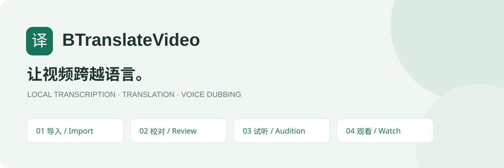

<p align="center"></p>

<p align="center"><a href="README.md">English</a> · <strong>简体中文</strong> · <a href="docs/installation.md">安装指南</a> · <a href="docs/usage.md">使用指南</a> · <a href="CONTRIBUTING.md">参与贡献</a></p>

# BTranslateVideo

**让视频跨越语言：识别、翻译、配音，全程本地。**

面向课程和动漫的本地视频译制工作台：识别原文、按上下文翻译、逐句校对与情绪试听，再生成保留背景声的目标语言配音视频。环境准备完成后，视频处理在本机运行。

当前支持平台：**Windows 10/11 x64 + NVIDIA CUDA GPU**。项目处于早期阶段；提供源码与安装脚本，尚无一键安装包。主要应用代码使用 MIT，IndexTTS 适配文件和模型另有许可证，见[许可范围](#许可范围)。

## 从视频到多语言成片

| 1 · 视频导入 | 2 · 字幕校对 | 3 · 配音与情绪 | 4 · 成片与下载 |
| --- | --- | --- | --- |
| 本地文件、12 种源语言、5 种译制目标、课程/动漫 | 按句搜索、编辑、比较优化建议 | 角色参考音、8 种情绪、3 档强度、单句试听 | 浏览器播放、字幕开关、MP4 / 双音轨 MKV |

- **本地处理**：Whisper 识别、Qwen 翻译、IndexTTS 配音、HTDemucs 背景分离；无云端推理依赖。
- **先校对再生成**：翻译结合相邻原文、角色和术语表；优化建议逐句选择采用，保留人工修改。
- **听一句再决定**：用当前草稿试听情绪，音色取自角色参考音；试听不覆盖字幕和成片。
- **完整表达**：短配音保持原速；过长配音在设定上限内加速，无法容纳时指出段落，不截掉句尾。
- **继续已有进度**：按内容复用语音和背景缓存，同条件语音自适应合批，取消后可重试。
- **观看与核对**：译制 MP4 可在网页播放、开关字幕；MKV 保留原音轨与原画质，便于对照。

<p align="center"></p>

截图使用仓库内的原创示例字幕，不包含用户视频、音色样本或模型生成结果。

## 快速开始

需要 Git、[uv](https://docs.astral.sh/uv/getting-started/installation/)、FFmpeg/FFprobe（加入 PATH）及支持 CUDA 的 NVIDIA 驱动。当前默认模型组合在 RTX 5070 Ti 16GB / 32GB 内存上验证过；这不是最低硬件要求。模型与环境占用较大，请预留充足磁盘空间。

```powershell
git clone https://github.com/MrmoLabs/BTranslateVideo.git
cd BTranslateVideo
ffmpeg -version
uv --version
.\setup.ps1
.\start.bat
```

打开 **http://127.0.0.1:7861**。首次准备需要联网下载模型和运行时；之后可离线处理。模型下载默认使用 ModelScope；其他下载源、代理、FFmpeg 安装和排错见[安装指南](docs/installation.md)。使用前请阅读[第三方许可](THIRD_PARTY_NOTICES.md)。

无需上传自己的视频到 GitHub。素材、参考录音、模型、缓存、成片与本地设置均保存在已忽略的本地目录中。

## 本地模型与运行方式

| 环节 | 默认组件 |
| --- | --- |
| 语音识别 | faster-whisper large-v3 · CUDA FP16 |
| 翻译与审校 | Qwen3-8B Q4_K_M · llama.cpp Vulkan |
| 多语言配音 | IndexTTS-2.5 · CUDA BF16 · 中文自适应合批，其他目标原生逐句合成 |
| 背景分离 | HTDemucs · 分块处理 |
| 混音与视频 | FFmpeg / FFprobe · H.264/AAC 页面预览 |

配音模型在连续调试时默认保温 10 分钟，避免反复加载；识别、翻译及需要重新分离背景音时自动让出显存，避免三套模型同时常驻。长视频校对可选每页 20/50/100 句；设置按常用参数与模型工具分组，诊断日志在独立面板查看。详细设计见[架构说明](docs/architecture.md)。

## 界面语言与源语言

顶部可切换简体中文 / English，浏览器记住选择，不刷新页面、不丢弃校对草稿。按钮、表单、任务状态和操作提示使用界面语言；用户字幕、项目名称和原始诊断日志保留原内容。

导入支持英语、日语、韩语、法语、德语、西班牙语、葡萄牙语、意大利语、俄语、阿拉伯语、印地语、中文，以及自动检测。译制目标可选择中文、英语、日语、西班牙语、阿拉伯语（IndexTTS-2.5）；旧项目默认中文，IndexTTS-2 仅支持中英目标。语言选项通过后台校验，翻译与断句提示按多语言设计。已补充法/德/西/韩例句的本地模型核对；其他语种与完整视频仍需实际素材验收。

## 音色库、批量编辑与日志

左侧提供项目、小说有声书、音色库、设置四个菜单页；项目列表支持创建、搜索、打开、重命名、移入回收站与恢复。音色预设可上传、试听、编辑、归档和恢复，再分配给项目角色；项目保存独立参考音副本，预设后续修改不会改变旧项目。

配音工作台支持同时查看和编辑多句、按角色与台词筛选、每页 20/50/100 句，以及勾选后批量设置角色、情绪和强度。字幕校对采用原文与译文直接编辑的对照表；两张表格都随页面自然滚动，单句细调和草稿试听在浮层中完成，关闭后保留原滚动位置。设置页切换菜单保留草稿。日志面板支持搜索、错误/警告筛选、自动跟随和完整进程日志下载。

已有项目可在标题下切换译制目标语言；切换前备份旧译文和输出，保留原文、时间轴与角色音色，然后重新翻译和配音。详细操作见[使用指南](docs/usage.md)。

## 连续配音调试

首个新片段加载 IndexTTS，后续试听与整片配音复用同一模型。设置里的“模型保温（分钟）”可设 0～60，默认 10；0 为每次任务后释放。空闲到期、切换其他 GPU 模型、取消、错误、关闭应用或模型文件变化时会释放/重新加载。配音页显示实时状态，提供“释放显存”。缓存命中时无需调用模型。

模型保温期间会占用显存；角色参考音被同路径替换时，会核对内容并清除旧参考条件。常驻进程只通过应用持有的本地管道收发任务，不额外开放 HTTP 端口。

## 使用边界

识别和翻译仍需校对；角色需要人工对应，情绪目前手动选择。背景分离可能残留原对白或损失音效，有独立背景音时可直接上传。不修改口型，也不擦除原画面字幕；页面字幕开关只控制后加的译文字幕。

实际流程验收以英语单人教程为主；日语/动漫的完整视频、多角色及所有硬件组合尚未全面验证。请先处理短片段确认效果。输入视频和参考声音需具备相应使用权限。

## 开发与贡献

```powershell
uv sync --locked --group dev
uv run --no-sync pytest -q
python scripts/check_repository.py
```

自动测试使用模型替身，真实 FFmpeg 测试需要 FFmpeg/FFprobe；不会在 CI 下载模型或证明模型听感。[贡献说明](CONTRIBUTING.md) · [测试范围](docs/testing.md) · [路线图](docs/roadmap.md) · [问题反馈](https://github.com/MrmoLabs/BTranslateVideo/issues/new/choose)

## 许可范围

本项目**原创应用代码与文档采用 [MIT](LICENSE)**。`scripts/tts_batch.py` 改编自 IndexTTS 推理代码，保留 [bilibili Model Use License Agreement](LICENSES/IndexTTS.txt)，不在 MIT 授权范围内。IndexTTS 本身也不是 MIT 模型；其他模型和运行时使用各自许可证。

完整范围、上游来源和限制请查看 [NOTICE](NOTICE) 与 [THIRD_PARTY_NOTICES.md](THIRD_PARTY_NOTICES.md)。下载的依赖、权重以及用户素材不随本仓库分发。本项目与 bilibili / IndexTeam 无隶属或官方合作关系。

### 直接录音与小说有声书

音色库可上传文件，或在 Windows 本机选择话筒、系统输出设备录制参考音。点击开始后才采集，29 秒自动停止，试听确认后再保存。

小说按书籍、章节管理，支持粘贴大段正文、自动分句、逐句编辑与音色／情绪覆盖、显示生成阶段和句子进度、取消续跑及复用缓存。章节完成后生成 WAV／MP3，多个章节可按顺序合并导出全书。小说保持自然语速，与视频任务共用保温模型；不经过翻译或字幕时间拉伸。详细操作见[使用指南](docs/usage.md)。正文、音色、临时录音与输出文件均只保存在本机并被 Git 忽略。
