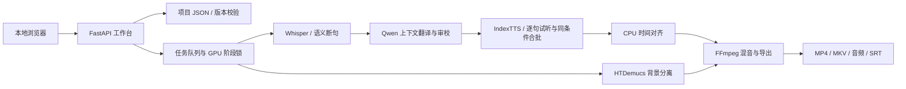

# 架构与数据设计

## 模块边界

- `app/server.py`：本机 API、输入校验、编辑冲突、静态页面与受限文件下载。
- `app/store.py`：项目状态、原子写入、重启恢复与日志。
- `app/pipeline.py`：任务阶段编排、取消、缓存、模型进程及单句试听。
- `app/segmentation.py` / `translation*.py`：按原始词对齐语义边界、上下文翻译与独立优化建议。
- `app/emotions.py` / `scripts/tts_batch.py`：情绪参数校验与 IndexTTS 兼容合批。后者保留上游许可证。
- `app/alignment.py` / `export_media.py`：完整时间轴规划、背景分离、混音、版本化成片。
- `app/static/`：无前端构建工具的 HTML/CSS/JavaScript 工作台。
- `scripts/prepare_*`：在线环境准备，与离线推理工作进程分开。

## 数据和一致性

每个项目保存在 `projects/<随机编号>/`。包含视频副本、字幕段落、角色参考音、缓存、输出和 `project.json`。段落使用稳定编号、起止时间、原文、中文及角色；手动情绪仅在选择预设时保存。旧项目缺失该字段时沿用参考音。

编辑请求携带版本号，旧版本和处理中编辑会被拒绝。替换已有结果前备份至项目 `history/`。翻译按钮只补齐空缺；优化已有译文先生成独立建议，经选择采用后才替换。单句试听使用草稿，不提交字幕，也不替换整片输出。

语音缓存关联中文、参考音内容、模型签名和情绪参数；对齐缓存还关联窗口、实际音长与倍速。短配音不慢放填满窗口。MP4 与混音使用内容标识，避免页面拿到旧成片。

## 并行策略

GPU 模型按阶段串行使用；IndexTTS 支持限时常驻，应用持有的 stdin 管道断开后进程退出。常驻进程在保温期间持有 GPU 文件锁，其他 GPU 阶段启动前由编排器释放它。空闲超时、手动释放、取消、崩溃和应用关闭也会终止进程。配音在单模型内按角色、情绪、强度和文本长度分组，自适应最多 4 段，失败降至 2 或 1。声学解码与声码器仍逐段执行。CPU 音频对齐可以并行。该设计优先控制显存占用和失败恢复，不承诺 GPU 始终满载。

## 安全与部署边界

服务仅监听 loopback，不带远程账户体系。API 拒绝非本机 Host 与跨站修改，下载接口限制文件类型；本机翻译地址也限制为 loopback。此应用不是经过加固的公网服务，不应直接代理到公网。详见 SECURITY.md。

## 界面国际化

`app/static/i18n.js` 负责语言选择、静态标记和带参数的界面文案；`locales/en.json` 以中文原文为键保存英语词条。占位符 `{0}`、`{1}` 可调整顺序，但不能丢失。文案翻译发生在插入用户数据之前，不扫描或改写整页文本，因此字幕、项目名和日志不会被误翻译。增加界面词条时同步更新语言包，并运行 `node tests/check_i18n.cjs`。

源视频语言由 `app/languages.py` 定义并在导入 API 校验；与网页界面语言分开保存。Whisper 使用源语种，Qwen 输出简体中文，配音继续使用中文。
