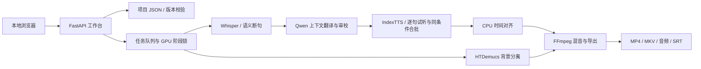

# 架构与数据设计

## 模块边界

- `app/server.py`：本机 API、输入校验、编辑冲突、静态页面与受限文件下载。
- `app/store.py`：项目状态、原子写入、重启恢复与日志。
- `app/pipeline.py`：任务阶段编排、取消、缓存、模型进程及单句试听。
- `app/segmentation.py` / `translation*.py`：按原始词对齐语义边界、上下文翻译与独立优化建议。
- `app/emotions.py` / `scripts/tts_batch.py`：情绪参数校验与 IndexTTS 兼容合批。后者保留上游许可证。
- `app/alignment.py` / `export_media.py`：完整时间轴规划、背景分离、混音、版本化成片。
- `app/static/`：无前端构建工具的 HTML/CSS/JavaScript 工作台。
- `scripts/prepare_*`：在线环境准备，与离线推理工作进程分开。

## 数据和一致性

每个项目保存在 `projects/<随机编号>/`。包含视频副本、字幕段落、角色参考音、缓存、输出和 `project.json`。段落使用稳定编号、起止时间、原文、中文及角色；手动情绪仅在选择预设时保存。旧项目缺失该字段时沿用参考音。

编辑请求携带版本号，旧版本和处理中编辑会被拒绝。替换已有结果前备份至项目 `history/`。翻译按钮只补齐空缺；优化已有译文先生成独立建议，经选择采用后才替换。单句试听使用草稿，不提交字幕，也不替换整片输出。

语音缓存关联中文、参考音内容、模型签名和情绪参数；对齐缓存还关联窗口、实际音长与倍速。短配音不慢放填满窗口。MP4 与混音使用内容标识，避免页面拿到旧成片。

## 并行策略

GPU 模型按阶段串行使用；IndexTTS 支持限时常驻，应用持有的 stdin 管道断开后进程退出。常驻进程在保温期间持有 GPU 文件锁，其他 GPU 阶段启动前由编排器释放它。空闲超时、手动释放、取消、崩溃和应用关闭也会终止进程。配音在单模型内按角色、情绪、强度和文本长度分组，自适应最多 4 段，失败降至 2 或 1。声学解码与声码器仍逐段执行。CPU 音频对齐可以并行。该设计优先控制显存占用和失败恢复，不承诺 GPU 始终满载。

## 安全与部署边界

服务仅监听 loopback，不带远程账户体系。API 拒绝非本机 Host 与跨站修改，下载接口限制文件类型；本机翻译地址也限制为 loopback。此应用不是经过加固的公网服务，不应直接代理到公网。详见 SECURITY.md。

## 界面国际化

`app/static/i18n.js` 负责语言选择、静态标记和带参数的界面文案；`locales/en.json` 以中文原文为键保存英语词条。占位符 `{0}`、`{1}` 可调整顺序，但不能丢失。文案翻译发生在插入用户数据之前，不扫描或改写整页文本，因此字幕、项目名和日志不会被误翻译。增加界面词条时同步更新语言包，并运行 `node tests/check_i18n.cjs`。

源视频语言由 `app/languages.py` 定义并在导入 API 校验；与网页界面语言分开保存。Whisper 使用源语种，Qwen 与 IndexTTS 使用项目目标语言。IndexTTS-2.5 暴露中英日西阿目标，旧项目默认中文。

## 音色预设与工作台

`app/voice_library.py` 保存本机音色元数据和分版本参考音频；归档为可逆状态。项目应用预设时创建独立参考音频副本并记录来源名称，预设更新不会改变既有项目。应用项目音色受任务忙碌保护，旧输出先归档，受影响配音按参考音哈希重新生成。

`app/static/workspace.js` 扩展主菜单、音色管理、多句配音与日志视图，复用字幕编辑的版本冲突、草稿和保存逻辑。日志接口限制浏览读取量，完整进程日志使用流式下载。`voices/` 与项目数据一样被 Git 和发布审计排除。

## 目标语言兼容

`app/languages.py` 统一目标选择、模型版本限制、字幕/音频文件名和 ISO 语言标签。为保留旧项目，字幕模型中的 `zh` 字段继续作为内部译文字段；非中文模型响应使用 `translation` 字段并在入口映射。目标语言进入翻译与语音缓存键，中文默认缓存键维持原样。切换目标使用版本冲突及任务忙碌保护，并备份旧结果。

非中文目标使用上游原生语言文本处理与单句推理，不混入中文批处理的文本规范化；同一套权重可继续保温复用。

项目管理使用独立的 `metadata_revision` 保护重命名、移入回收站和恢复的并发操作，不改变字幕编辑版本。删除仅原子写入 `deleted_at`，不移动或移除项目目录；恢复保留素材、参考音和缓存。默认读取排除回收站项目，处理与编辑接口继续使用同一队列锁拒绝忙碌项目变更。

界面使用主菜单索引与项目详情两个层级；隐藏页面保留已编辑的表单，切换项目才执行保存或放弃流程。字幕和配音表格使用文档滚动，单句浮层记录并恢复文档位置，关闭后恢复键盘焦点。设置表单保存时比较提交时的编辑代次，避免请求等待期间的新输入被标记为已保存。

`app/recording.py` 只在显式开始后打开 WASAPI 流，按随机会话编号管理短录音、音量和停止事件；停止后的 WAV 经现有音色上传与归一化路径保存。采集有 29 秒样本／墙钟上限，取消和服务关闭释放自己的流，不启动其他应用或修改系统音频设置。

`app/audiobooks.py` 把书籍元数据与章节正文分开原子存储，章节版本号保护并发编辑。长文按确定性规则分句，句子可覆盖默认音色。配音计划使用现有 `Pipeline.pool`、取消事件和 `TTSSession`，按句写入缓存与快照参考音，不进行字幕时间对齐。不同采样率先转换到共同 PCM 格式，再流式合并；避免直接拼接不同采样率造成语速变化，也不将全书 PCM 一次性装入内存。章节与全书输出使用内容标识和原子替换。
